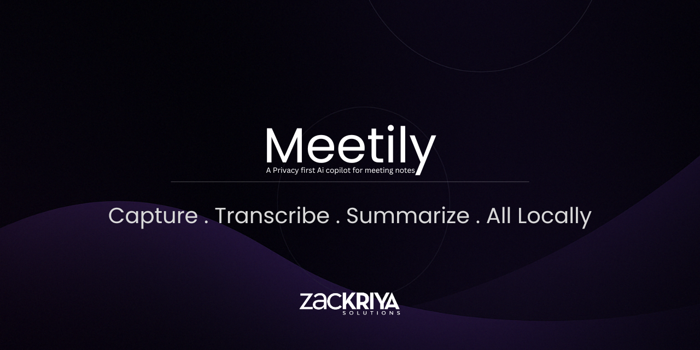
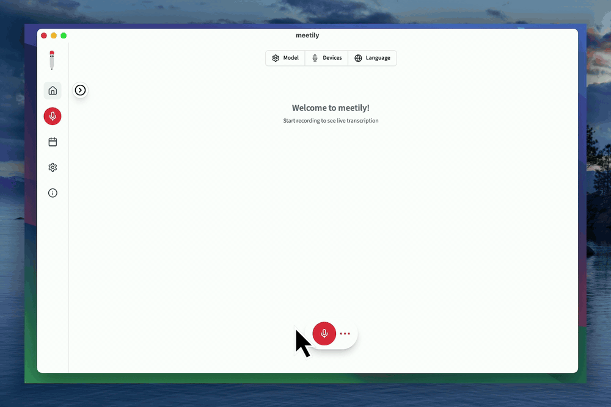
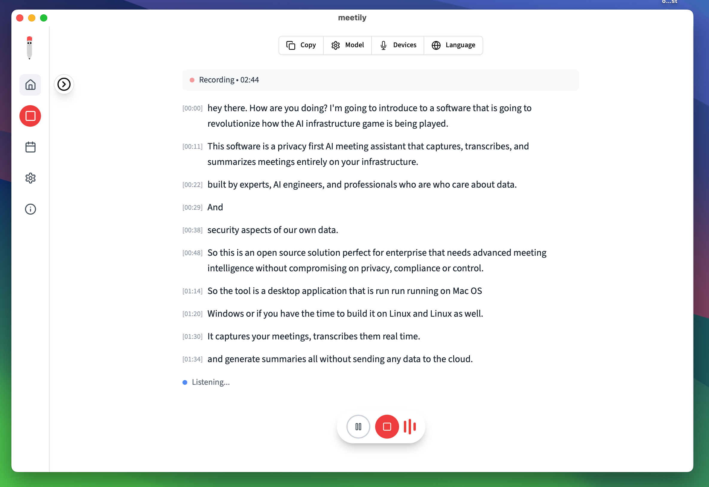
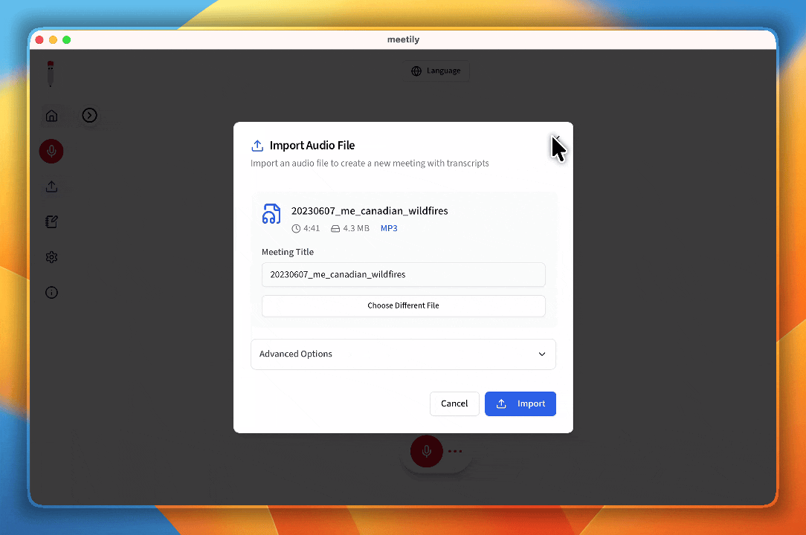
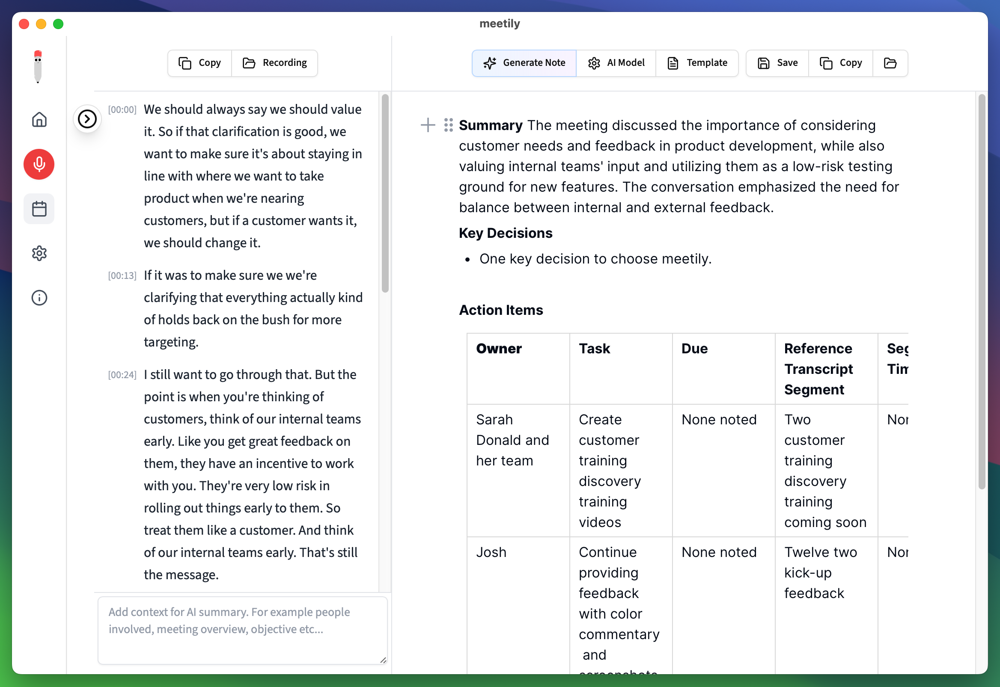
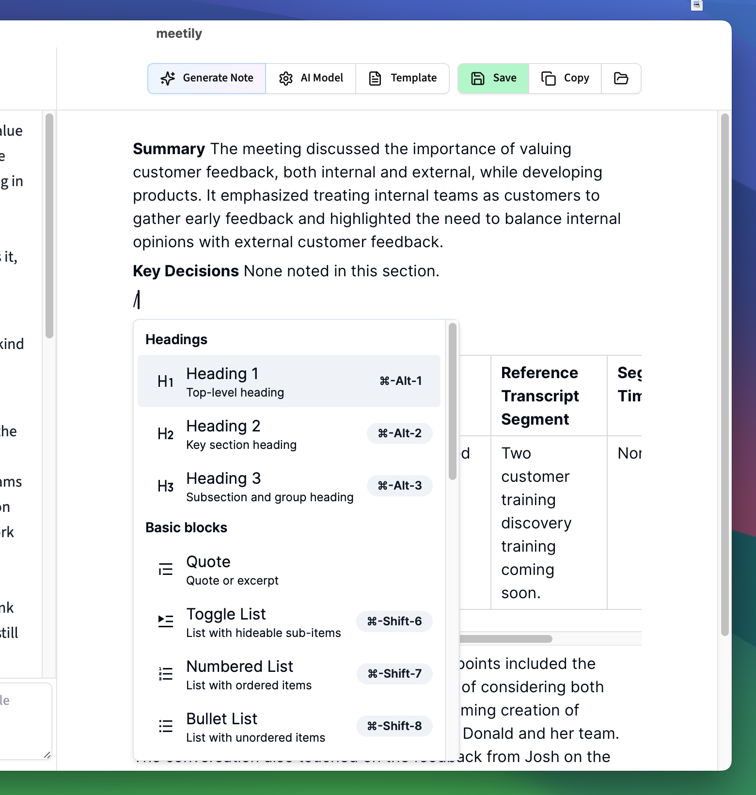
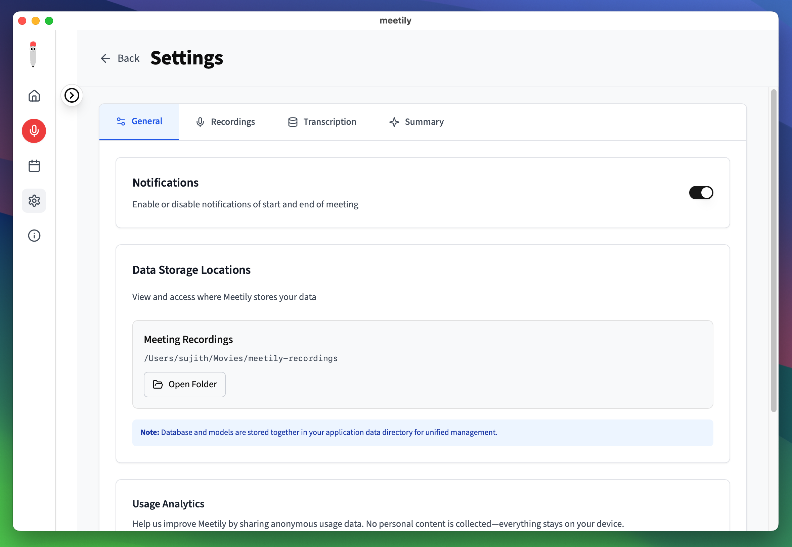
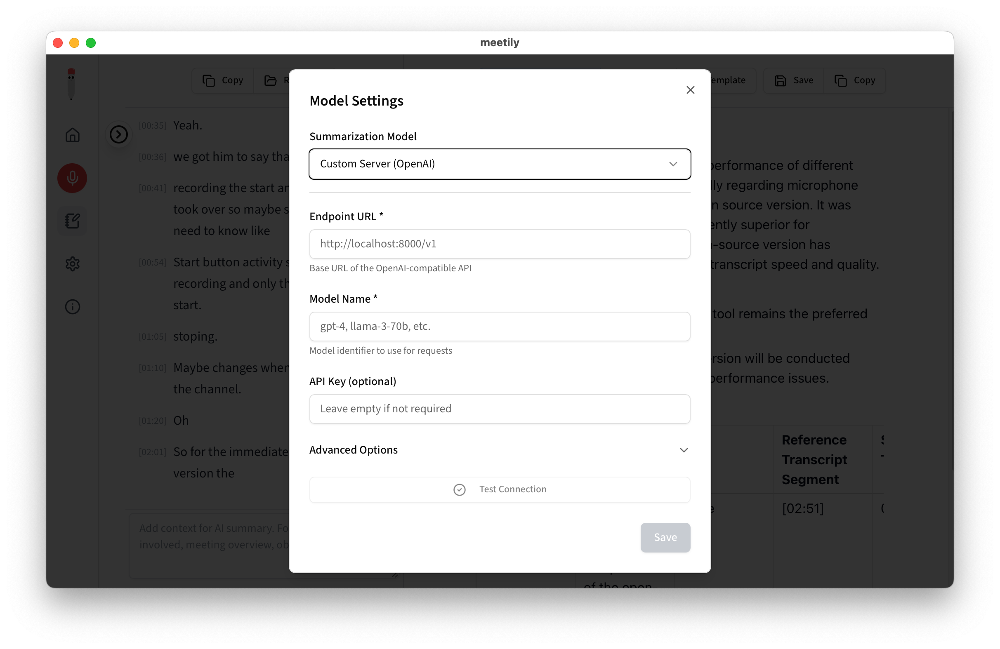
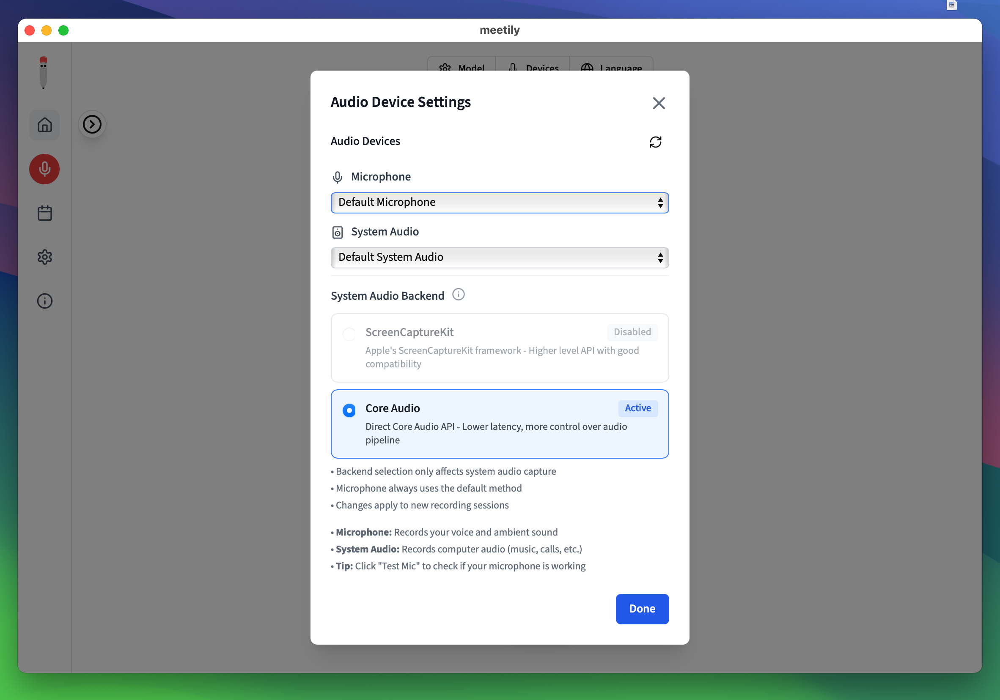

    <h1>
        
         
        Privacy-First AI Meeting Assistant
    </h1>
     
     
    
    
 
    
    
    
     
    <h3>
     
    Open Source • Privacy-First • Enterprise-Ready
    </h3>
    

    <a href="https://samobranka.ai"><b>Website</b></a>

    

A privacy-first AI meeting assistant that captures, transcribes, and summarizes meetings entirely on your infrastructure. Built by expert AI engineers passionate about data sovereignty and open source solutions. Perfect for enterprises that need advanced meeting intelligence without compromising on privacy, compliance, or control.

    

---

Table of Contents

- [Introduction](#introduction)
- [Why Samobranka?](#why-samobranka)
- [Features](#features)
- [Installation](#installation)
- [Key Features in Action](#key-features-in-action)
- [System Architecture](#system-architecture)
- [For Developers](#for-developers)
- [Contributing](#contributing)
- [License](#license)

## Introduction

Samobranka is a privacy-first AI meeting assistant that runs entirely on your local machine. It captures your meetings, transcribes them in real-time, and generates summaries with a local model by default. Audio and transcription never leave your device. If you choose a cloud AI provider for summaries, only the transcript text is sent to it. This makes it the perfect solution for professionals and enterprises who need to maintain complete control over their sensitive information.

## Why Samobranka?

While there are many meeting transcription tools available, this solution stands out by offering:

- **Privacy First:** All processing happens locally on your device.
- **Cost-Effective:** Uses open-source AI models instead of expensive APIs.
- **Flexible:** Works offline and supports multiple meeting platforms.
- **Customizable:** Self-host and modify for your specific needs.

Note: Official builds are only on samobranka.ai and github.com/timurmazitov/samobranka/releases.
    

The Privacy Problem

Meeting AI tools create significant privacy and compliance risks across all sectors:

- **$4.4M average cost per data breach** (IBM 2024)
- **€5.88 billion in GDPR fines** issued by 2025
- **400+ unlawful recording cases** filed in California this year

Whether you're a defense consultant, enterprise executive, legal professional, or healthcare provider, your sensitive discussions shouldn't live on servers you don't control. Cloud meeting tools promise convenience but deliver privacy nightmares with unclear data storage practices and potential unauthorized access.

**Samobranka solves this:** Complete data sovereignty on your infrastructure, zero vendor lock-in, and full control over your sensitive conversations.

## Features

- **Local First:** All processing is done on your machine. No data ever leaves your computer.
- **Real-time Transcription:** Get a live transcript of your meeting as it happens.
- **AI-Powered Summaries:** Generate summaries of your meetings using powerful language models.
- **Multi-Platform:** Native apps for Windows and macOS (Apple Silicon). On Linux, build from source.
- **Open Source:** Samobranka is open source and free to use.
- **Flexible AI Provider Support:** Choose from Ollama (local), Claude, Groq, OpenRouter, or use your own OpenAI-compatible endpoint.

## Installation

### 🪟 **Windows**

1. Download the latest `x64-setup.exe` from [Releases](https://github.com/timurmazitov/samobranka/releases/latest)
2. Run the installer

> **Windows compatibility:** The packaged installer uses a Vulkan-enabled Whisper build. It requires an AVX2-capable x64 CPU; AVX-512 is not required. CUDA acceleration requires a source build configured with a compatible NVIDIA CUDA toolchain.

### 🍎 **macOS**

1. Download the latest `samobranka_<version>_aarch64.dmg` from [Releases](https://github.com/timurmazitov/samobranka/releases/latest)
2. Open the downloaded `.dmg` file
3. Drag **Samobranka** to your Applications folder
4. Open **Samobranka** from Applications folder

### 🐧 **Linux**

1. Download the latest `.deb` or `.AppImage` package for Linux x64 from [Releases](https://github.com/timurmazitov/samobranka/releases/latest).
2. Install or run your preferred package:
   - **Debian/Ubuntu (.deb):** Open a terminal in the download folder and run `sudo apt install ./<downloaded-file>.deb`.
   - **AppImage:** Open the file’s properties, allow it to run as a program, then double-click it to launch **Samobranka**.

To build from source, see [Building on Linux](docs/building_in_linux.md) or [General Build Instructions](docs/BUILDING.md).

## Key Features in Action

### 🎯 Local Transcription

Transcribe meetings entirely on your device using **Whisper** or **Parakeet** models. No cloud required.

    

### 📥 Import & Enhance `Beta`

Import existing audio files to generate transcripts, or enhance to re-transcribe any recorded meeting with a different model or language, all processed locally.

> Contributed by [Jeremi Joslin](https://github.com/jeremi), improved by [Vishnu P S](https://github.com/p-s-vishnu) and [Mohammed Safvan](https://github.com/mohammedsafvan)

    

### 🤖 AI-Powered Summaries

Generate meeting summaries with your choice of AI provider. **Ollama** (local) is recommended, with support for Claude, Groq, OpenRouter, and OpenAI.

    

    

### 🔒 Privacy-First Design

All data stays on your machine. Transcription models, recordings, and transcripts are stored locally.

    

### 🌐 Custom OpenAI Endpoint Support

Use your own OpenAI-compatible endpoint for AI summaries. Perfect for organizations with custom AI infrastructure or preferred providers.

    

### 🎙️ Professional Audio Mixing

Capture microphone and system audio simultaneously with intelligent ducking and clipping prevention.

    

### ⚡ GPU Acceleration

Acceleration depends on the platform and build you use:

- **macOS packages:** Metal and CoreML are enabled automatically.
- **Windows packages:** Whisper is built with Vulkan support.
- **Linux:** Build from source with the acceleration configuration appropriate for your system.

CUDA is available through an appropriately configured NVIDIA source build; the standard Windows installer does not select it automatically.

## System Architecture

Samobranka is a single, self-contained application built with [Tauri](https://tauri.app/). It uses a Rust-based backend to handle all the core logic, and a Next.js frontend for the user interface.

For more details, see the [Architecture documentation](docs/architecture.md).

## For Developers

If you want to contribute to Samobranka or build it from source, you'll need to have Rust and Node.js installed. For detailed build instructions, please see the [Building from Source guide](docs/BUILDING.md).

## Contributing

We welcome contributions to Samobranka! Before starting, search existing issues and PRs and read [CONTRIBUTING.md](CONTRIBUTING.md). Coding agents should also follow [AGENTS.md](AGENTS.md). Use the [issue forms](https://github.com/timurmazitov/samobranka/issues/new/choose) for actionable bug reports, feature requests, and documentation problems.

Thanks for all the contributions. Our community is what makes this project possible.

## License

MIT License - Feel free to use this project for your own purposes.

## Acknowledgments

- We borrowed some code from [Whisper.cpp](https://github.com/ggerganov/whisper.cpp).
- We borrowed some code from [Screenpipe](https://github.com/mediar-ai/screenpipe).
- We borrowed some code from [transcribe-rs](https://crates.io/crates/transcribe-rs).
- Thanks to **NVIDIA** for developing the **Parakeet** model.
- Thanks to [istupakov](https://huggingface.co/istupakov/parakeet-tdt-0.6b-v3-onnx) for providing the **ONNX conversion** of the Parakeet model.
